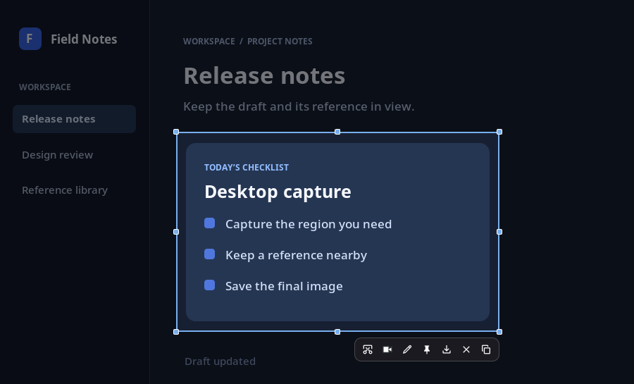

<div align="center">
  
  <h1>Pinshot</h1>
  <p><strong>Take screenshots, pin references, and record GIFs on GNOME Wayland.</strong></p>
  <p><strong>English</strong> · <a href="README.zh-CN.md">Simplified Chinese</a></p>
  <p>
    <a href="#installation"></a>
    <a href="#installation"></a>
    <a href="Cargo.toml"></a>
    <a href="LICENSE"></a>
  </p>
  <p><a href="#features">Features</a> · <a href="#installation">Installation</a> · <a href="#quick-start">Quick start</a> · <a href="https://github.com/dgxz99/pinshot/issues">Report an issue</a></p>
</div>

Pin a screenshot, an image, or a copied snippet next to your work so you can refer to it without switching windows. Pins stay above ordinary windows and follow you across workspaces. They’re drawn by GNOME Shell, so they don’t show up in `Alt+Tab`.

**Supported desktop:** GNOME Shell 51 on Wayland. Tested on Arch Linux with GNOME Shell 51.1.



## Features

| Feature | What it does |
| --- | --- |
| Region capture | Freeze the desktop and adjust the selection with eight handles. Copy, save, pin, or annotate it. GNOME’s own `Print` shortcut is unchanged. |
| Desktop pins | Keep screenshots, clipboard images, and text cards on top. Move or resize them, change opacity, collapse them, or let clicks pass through. |
| Scrolling capture | Capture a page or scrollable panel vertically or horizontally. Extend either end of the chosen axis without repeating overlapping content. |
| GIF recording | Choose a frame rate before recording, include the pointer, and stop to save a looping GIF. |
| Annotation | Open the selection or edit an existing pin in [Satty](https://github.com/Satty-org/Satty). |

## Installation

### Requirements

| Dependency | Used for |
| --- | --- |
| GNOME Shell 51, `gnome-extensions` | Running and managing the extension |
| Git, Rust and Cargo (tested with Rust 1.100), a C toolchain, `glib-compile-schemas` | Building the CLI and compiling the extension’s settings schema |
| `wl-clipboard`, `pango-view` (Pango) | Clipboard access and text cards |
| GNOME ScreenCast Portal, PipeWire, GStreamer | Scrolling capture and GIF recording. The build needs `pkg-config` and GStreamer Core, App, and Video development files. At runtime, GStreamer needs `pipewiresrc`, `videorate`, and `videoconvert`. |
| `satty`, `notify-send` (libnotify) | Optional: annotation and desktop notifications |

On Arch Linux, with GNOME and Rust already installed, the other required tools and libraries are available as:

```bash
sudo pacman -S --needed git base-devel glib2 wl-clipboard pango xdg-desktop-portal-gnome \
  pipewire wireplumber gstreamer gst-plugins-base gst-plugins-base-libs gst-plugin-pipewire
```

Install `satty` and `libnotify` if you want annotation and desktop notifications.

### Build from source

```bash
git clone https://github.com/dgxz99/pinshot.git
cd pinshot
./scripts/install.sh
```

Run the installer as your normal user. It installs the CLI at `~/.local/bin/pinshot` and the extension at `~/.local/share/gnome-shell/extensions/pinshot@dgxz99`. **Log out and back in** after the first install or after updating the extension code, then enable it and check the connection:

```bash
gnome-extensions enable pinshot@dgxz99
~/.local/bin/pinshot ping
```

A response of `gnome-shell-51` means the extension is online. Add `~/.local/bin` to `PATH` to run the commands below as `pinshot`, or use the full path instead.

To update, pull the latest changes and rerun `./scripts/install.sh`. For development, `--symlink` links the extension directory to the checkout. `--skip-build` installs an existing `target/release/pinshot` binary; it does not rebuild it.

## Quick start

| Action | Default shortcut | CLI |
| --- | --- | --- |
| Capture a region | `Super+Shift+P` | `pinshot capture` |
| Start a vertical scrolling capture | `Super+Shift+L` | `pinshot longshot` |
| Pin an image or text from the clipboard | `Super+Shift+V` | `pinshot pin-clipboard` |
| Make all pins respond to clicks again | `Super+Shift+U` | `pinshot unghost-all` |
| Record a GIF | Not bound | `pinshot gif` |
| Capture and annotate | Not bound | `pinshot capture-edit` |
| Show or hide all pins | Not bound | `pinshot toggle-hide` |
| Restore the most recently closed pin | Not bound | `pinshot restore-last` |

`Super` is usually the Windows key. Open preferences with `gnome-extensions prefs pinshot@dgxz99` to change or disable bindings. The preferences UI currently uses Simplified Chinese.

### Capture, copy, or pin

1. Press `Super+Shift+P`, drag out a region, and release. Move the selection by dragging inside it, or resize it with the handles.
2. The toolbar goes from left to right: **Scrolling capture → GIF → Annotate → Pin → Save → Cancel → Copy**. `Enter` copies only; `Esc` or right-click cancels. Save exports a PNG without changing the clipboard. Pin puts the selection on the desktop and copies it. Use `pinshot capture-pin` if you want `Enter` to pin instead.
3. In the selection, `Ctrl+C` copies, `P` pins, and `E` opens Satty. These three bindings are configurable independently of global shortcuts: for example, set `Ctrl+T` to pin the current selection without changing what `Ctrl+T` does outside it. In Satty, `Enter` saves and copies the annotated capture; `Esc` leaves the clipboard unchanged.

### Work with pins

Copy an image or some text in any app and press `Super+Shift+V`. Pinshot doesn’t take over the app’s `Ctrl+C`. A screenshot copied by Pinshot keeps its original display size when pinned again, subject to fit-to-screen for large images. For external images on scaled displays, the clipboard image settings on the Screenshots page offer a device-pixel 1:1 option.

| Action | Gesture |
| --- | --- |
| Select and bring forward / move | Left-click / drag |
| Close and keep in history | Double-click or middle-click |
| Zoom / change opacity | Scroll / `Ctrl`+scroll |
| Copy, annotate, save, or reset the size | Right-click for the menu |
| Collapse or expand a pin | Right-click menu or `Shift+R` |
| Enable click-through | Right-click menu or `T` |

When a pin receives keyboard input, `Ctrl+C` copies it, `E` opens Satty, `0` resets its size, and `Esc` closes it. If another window is receiving the keys, use the pin’s right-click menu instead. Once click-through is enabled, use `Super+Shift+U` or `pinshot unghost-all` to regain mouse control. By default, pins on a display temporarily hide when an app goes fullscreen there.

### Capture scrolling content

1. Select the area in a normal capture, then choose vertical or horizontal from the leftmost toolbar button. You can also start a dedicated capture with `pinshot longshot` or `pinshot longshot --horizontal`.
2. Choose the monitor in GNOME’s screen-sharing dialog. A normal capture reuses the selection after authorization; the dedicated command asks you to select the area on the shared monitor. The whole selection must fit on that monitor, with room outside it for the controls.
3. Scroll along the selected axis in either direction. If Pinshot asks you to scroll back, return to where stitching last succeeded, then continue with smaller steps. For something like a scrollable code block, select the content and leave unrelated sidebars or overlays out of the frame.
4. Choose Annotate, Pin, Save, or Copy to finish, or click × to discard. The controls and capture border stay out of the output. Capture finishes automatically when the scrolling axis reaches 24,000 pixels or the memory limit is reached.

GNOME can remember the shared monitor. To choose a different one, use `pinshot longshot --choose-screen`. GIF recording shares this authorization and cannot run at the same time as scrolling capture. Pinshot closes the screen-sharing session when it’s done. Stopping sharing from GNOME cancels the capture in progress.

### Record a GIF

1. Choose the camera icon in a normal capture, or run `pinshot gif` and confirm a region. The blue outline and `00:00` timer mean it’s ready, not recording.
2. Choose **5, 10, 16, 24, or 30 FPS** (default: 10). Click the red circle to start the screen-sharing flow. If you need a different monitor, use `pinshot gif --choose-screen`.
3. When the outline turns red and the timer runs, click the square stop button to save, or × to discard. Saving shows the full file path in a desktop notification when `notify-send` is available. It does not copy the GIF to the clipboard or add it to pin history.

GIFs loop and include the pointer, but not audio. The chosen FPS is a sampling ceiling, not a promise that the screen will update that often. Large selections are scaled proportionally to a longest edge of 1,280 pixels and a total area of at most 1,280 × 720 pixels. There is no fixed time limit; at 64 MiB Pinshot saves the portion already recorded.

## Saving and settings

Open the Screenshots page in the extension preferences:

| Setting | Behavior |
| --- | --- |
| Save directory | Shared by Pinshot PNGs and GIFs. Use an absolute path or one starting with `~/`, then click Apply next to the field. A blank field uses `general.save_dir` in the Core configuration, which defaults to `~/Pictures/Pinshots`. |
| Filename prefix | Defaults to `pinshot`. Filenames include the local save time, such as `pinshot-20261121-214530.png`. A suffix like `-1` avoids overwriting another file. |
| Automatically save to disk | Off by default. Enable it to also export results you pin or confirm in Satty. Copy still only copies. Explicit Save and GIF stopping work with the toggle off. |
| Screenshot completion notifications | Off by default. Does not control GIF save notifications, explicit save notifications, or GNOME’s own `Print` workflow. |

### Cache and history

`pinshot status` reports the frontend status, cache and configuration paths, and pin counts. Cache files live under `~/.cache/pinshot/` (or `$XDG_CACHE_HOME/pinshot/`). The default targets are 200 MB and 14 days, with inactive pins cleaned up first. Pins aren’t reopened automatically on login unless you enable `restore_on_startup`; use `pinshot restore-last` to recover a recent pin still in the cache.

```bash
pinshot clear-history       # Clear inactive history, keep active pins
pinshot clear-history --all # Also close active pins and delete their cached files
```

Clearing history is irreversible, but does not delete exported PNG or GIF files.

<details>
<summary>Core configuration</summary>

`pinshot status` creates a starter configuration if needed. It lives at `~/.config/pinshot/config.toml` or `$XDG_CONFIG_HOME/pinshot/config.toml`. Here are some settings you can change:

```toml
[general]
save_dir = "~/Pictures/Pinshots"
restore_on_startup = false
notify_on_save = true             # Notifications for explicit PNG saves

[cache]
max_size_mb = 200
max_age_days = 14

[text_card]
theme = "auto"                    # auto, light, or dark
max_width_px = 680
max_lines = 80
```

Text-card settings apply to new cards. The extension reads `[pin]` settings (such as `default_opacity`, `mini_size_px`, and `hide_on_fullscreen`) when it starts. After changing those, log out of GNOME and back in; no rebuild is needed.

</details>

## Troubleshooting and uninstalling

- **The extension is offline:** Verify you’re in a GNOME Shell 51 Wayland session and check `gnome-extensions info pinshot@dgxz99`. If GNOME is still running older extension code, log out and back in.
- **A shortcut does nothing:** Try the corresponding CLI command first, then check whether the binding is disabled or conflicts with a system shortcut.
- **Need logs?** Run `journalctl --user -b -o cat | grep -i pinshot`. When [reporting an issue](https://github.com/dgxz99/pinshot/issues), include your GNOME Shell version, whether the session is Wayland, and steps to reproduce it.
- **Uninstall:** Run `./scripts/uninstall.sh`. It preserves the Core configuration and cache unless you pass `--purge`. Exported files are not removed.

## License

Pinshot is available under the [MIT License](LICENSE).
