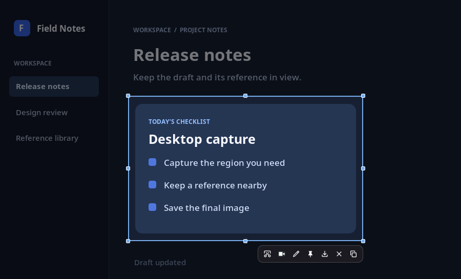

<div align="center">
  
  <h1>Pinshot</h1>
  <p><strong>在 GNOME Wayland 上截图、贴图和录制 GIF。</strong></p>
  <p><a href="README.md">English</a> · <strong>简体中文</strong></p>
  <p>
    <a href="#安装"></a>
    <a href="#安装"></a>
    <a href="Cargo.toml"></a>
    <a href="LICENSE"></a>
  </p>
  <p><a href="#功能">功能</a> · <a href="#安装">安装</a> · <a href="#快速上手">快速上手</a> · <a href="#路线图">路线图</a> · <a href="https://github.com/dgxz99/pinshot/issues">反馈问题</a></p>
</div>

把截图、图片或刚复制的代码贴在桌面上，对照参考资料时不用来回切窗口。贴图默认在普通窗口上方，切换工作区后仍可见。它由 GNOME Shell 直接绘制，不会出现在 `Alt+Tab` 列表里。

**支持环境：** GNOME Shell 50 / 51（Wayland）。



## 功能

| 功能 | 可以做什么 |
| --- | --- |
| 区域与全屏截图 | 冻结画面并用八个手柄调整选区，或一键截取当前显示器全屏，再复制、保存、原位贴图或标注。 |
| 桌面贴图 | 把截图、剪贴板图片或文字卡片固定在桌面上。区域截图按 1:1 原位贴出，可移动、缩放、调不透明度、收起或开启点击穿透。 |
| 贴图离线划词（OCR） | 贴图后自动在后台本地识别中英文与代码文字，鼠标移到文字上即可直接划词复制，无需点击 OCR 按钮，完全离线运行。 |
| 滚动长截图 | 纵向或横向截取网页与滚动容器，可沿所选轴向两端补图，来回滚动不重复拼接。 |
| GIF 录制 | 开录前选帧率，录入鼠标指针，停止后保存为循环 GIF。 |
| 顶栏菜单与应用入口 | GNOME 顶栏图标（支持彩色或单色切换），集成常用操作与快捷键开关；提供应用启动器入口。 |
| 标注 | 可选：使用 [Satty](https://github.com/Satty-org/Satty) 标注选区或编辑已有贴图。 |

## 安装

### Arch Linux（AUR）

```bash
yay -S pinshot-bin   # 预编译二进制
# 或
yay -S pinshot       # 从源码构建
```

### 一键安装脚本（Linux `x86_64`）

```bash
curl -fsSL https://raw.githubusercontent.com/dgxz99/pinshot/main/scripts/install.sh | bash
```

- 指定版本：`curl -fsSL https://raw.githubusercontent.com/dgxz99/pinshot/main/scripts/install.sh | PINSHOT_VERSION=v0.1.0 bash`

### 从源码构建

除运行依赖外，还需要 Git、Rust 与 Cargo（已用 Rust 1.100 验证）、C 工具链、`pkg-config`、`glib-compile-schemas` 和 GStreamer Core/App/Video 开发库：

```bash
sudo pacman -S --needed git base-devel glib2 wl-clipboard pango xdg-desktop-portal-gnome pipewire wireplumber gstreamer gst-plugins-base gst-plugins-base-libs gst-plugin-pipewire
```

```bash
git clone https://github.com/dgxz99/pinshot.git
cd pinshot
./scripts/install.sh
```

开发时可加 `--symlink` 将扩展目录软链接到源码；`--skip-build` 直接安装已有的 `target/release/pinshot` 而不重编。

### 依赖

| 依赖 | 用途 |
| --- | --- |
| GNOME Shell 50 / 51、`gnome-extensions` | 运行和管理扩展 |
| `wl-clipboard`、`pango-view`（Pango） | 读取剪贴板和生成文字卡片 |
| GNOME ScreenCast Portal、PipeWire、GStreamer（`pipewiresrc`、`videorate`、`videoconvert`） | 长截图和 GIF 录制 |
| `satty`、`notify-send`（`libnotify`） | 可选：标注和桌面通知 |

### 启用扩展

GNOME Wayland 仅在会话启动时加载新安装或更新后的扩展，因此安装后需**注销并重新登录 GNOME**：

- **脚本 / 源码安装**：脚本已自动将扩展设为自启，重登录后直接生效。
- **AUR 安装**：系统级安装包不会修改用户 GNOME 配置，重登录后执行一次启用（或在「扩展」应用中开启）：

```bash
gnome-extensions enable pinshot@dgxz99
```

验证扩展是否在线（返回 `gnome-shell-50` 或 `gnome-shell-51`）：

```bash
pinshot ping
```

> 脚本安装如提示找不到 `pinshot`，请将 `~/.local/bin` 加入 `PATH`：
> - **Bash / Zsh**：在 `~/.bashrc` 或 `~/.zshrc` 中添加 `export PATH="$HOME/.local/bin:$PATH"`
> - **Fish**：运行 `fish_add_path ~/.local/bin`

## 快速上手

可通过全局快捷键、GNOME 顶栏图标菜单、Pinshot 应用图标（左键打开首选项、右键触发快捷操作）或 CLI 使用：

| 操作 | 默认快捷键 | 等效命令 |
| --- | --- | --- |
| 区域截图 | `Super+Shift+P` | `pinshot capture` |
| 截取当前全屏 | 未绑定 | `pinshot capture-fullscreen` |
| 纵向长截图 | `Super+Shift+L` | `pinshot longshot` |
| 把剪贴板图片或文字贴到桌面 | `Super+Shift+V` | `pinshot pin-clipboard` |
| 解除全部贴图的点击穿透 | `Super+Shift+U` | `pinshot unghost-all` |
| 录制 GIF | 未绑定 | `pinshot gif` |
| 截图后标注 | 未绑定 | `pinshot capture-edit` |
| 显示或隐藏全部贴图 | 未绑定 | `pinshot toggle-hide` |
| 恢复最近关闭的贴图 | 未绑定 | `pinshot restore-last` |

`Super` 通常是键盘上的 Windows 键。可通过顶栏菜单、Pinshot 应用图标或 `gnome-extensions prefs pinshot@dgxz99` 打开扩展首选项。

### 截图、复制或贴图

1. 按 `Super+Shift+P` 拖出选区。松手后可以拖框内移动，或拉动手柄调整大小。
2. 工具条从左到右是 **长截图 → GIF → 标注 → 贴图 → 保存 → 取消 → 复制**。`Enter` 只复制，`Esc` 或右键取消。点保存只导出 PNG，不改剪贴板；点贴图会把选区按 1:1 原位贴到桌面并复制。想让 `Enter` 默认贴图，可以运行 `pinshot capture-pin`。
3. 截取当前显示器全屏可通过顶栏菜单、`pinshot capture-fullscreen` 或自定义快捷键触发：轻闪一下后复制到剪贴板，并遵循自动保存和通知设置。
4. 框选时默认 `Ctrl+C` 复制、`P` 贴图、`E` 打开 Satty。这三个局部快捷键可独立设置，例如把 `Ctrl+T` 设为贴出当前选区，不会改变它在框选之外的行为。进入 Satty 后，按 `Enter` 保存并复制标注结果，按 `Esc` 退出且不改剪贴板。

### 操作贴图

在原应用复制图片或文字，再按 `Super+Shift+V`。Pinshot 不接管其他应用的 `Ctrl+C`。经 Pinshot 复制的截图再次贴出时会保留原始显示大小，大图仍会适屏。高分屏下的外部图片可在「截图 → 剪贴板图片」开启按设备像素 1:1 显示。

| 操作 | 如何触发 |
| --- | --- |
| 选中并置顶 / 移动 | 空白区、边缘热区或按住 `Alt` 时左键拖动 |
| 贴图划词选字 | 鼠标悬停文字上直接左键拖动（双击文字选词，点击浮动「复制」或按 `Ctrl+C` 复制） |
| 关闭并保留历史 | 双击空白区或单击中键 |
| 缩放 / 调不透明度 | 滚轮 / `Ctrl`+滚轮 |
| 复制、标注、保存、OCR 或恢复原尺寸 | 打开右键菜单 |
| 收起或展开迷你态 | 右键菜单或 `Shift+R` |
| 开启点击穿透 | 右键菜单或 `T` |

贴图收到键盘事件时，`Ctrl+C` 复制选中文字（无选区时复制图片）、`Ctrl+A` 全选识别文字、`E` 打开 Satty、`0` 恢复原尺寸、`Esc` 清除选区或关闭贴图。若按键仍发给后方窗口，请用右键菜单。开启穿透后，按 `Super+Shift+U`、点顶栏菜单或运行 `pinshot unghost-all` 均可恢复鼠标操作。默认情况下，应用全屏时会暂时隐藏该显示器上的贴图。

### 滚动长截图

1. 普通截图框选后，点工具条最左侧的长截图图标，选择纵向或横向；也可从顶栏菜单或单独运行 `pinshot longshot` / `pinshot longshot --horizontal`。
2. 在 GNOME 共享对话框中选择显示器。从普通截图进入会沿用原选区；从独立入口进入则在授权屏幕上框选。整个选区必须位于该屏幕内，且框外要留出工具条的位置。
3. 沿所选轴向任一端滚动。若提示回滚，先回到上次拼接成功的位置，再小幅滚动。截取内部滚动的代码框时，尽量只框正文，避开无关侧栏或动态浮层。
4. 点标注、贴图、保存或复制结束并输出；点 × 放弃。边框和工具条不会进入成品。沿滚动轴达到 24,000 像素或触及内存上限时会自动结束采集。

可让 GNOME 记住共享屏幕，需要换屏时用 `pinshot longshot --choose-screen`。GIF 和长截图共用这个授权，但不能同时运行。采集结束后 Pinshot 会关闭共享会话。从 GNOME 停止共享会取消本次采集。

### 录制 GIF

1. 点普通截图工具条上的摄像机、点顶栏菜单「录制 GIF」，或执行 `pinshot gif` 再确认一个选区。蓝框和 `00:00` 表示待录，此时不会启动屏幕共享。
2. 选择 **5、10、16、24 或 30 FPS**（默认 10），再点红色圆形按钮请求屏幕共享。需要重选屏幕时，可用 `pinshot gif --choose-screen`。
3. 红框和计时表示录制中。点方形停止按钮保存，点 × 放弃。系统装有 `notify-send` 时，保存成功会通知完整文件路径；不会复制到剪贴板，也不会写入贴图历史。

GIF 循环播放，会录入鼠标指针，不录声音。帧率是采样上限，实际帧数取决于画面更新。大选区会等比缩小，长边不超过 1,280 像素，总像素数不超过 1,280 × 720。没有固定时长上限，文件达到 64 MiB 时会保存已录部分。

## 保存与设置

扩展首选项包含 **快捷键**、**截图**、**界面** 三个分页：

| 设置 | 行为 |
| --- | --- |
| 保存目录 | PNG 和 GIF 共用。填绝对路径或 `~/`，再点应用。留空时使用 `config.toml` 的 `general.save_dir`（默认 `~/Pictures/Pinshots`）。 |
| 文件名前缀 | 默认 `pinshot`，加上本地保存时间，例如 `pinshot-20261121-214530.png`，重名时追加 `-1`、`-2` 序号。 |
| 自动保存到目录 | 默认关闭。开启后，贴图、全屏截图和 Satty 标注结果会额外导出到目录。主动保存和停止 GIF 始终落盘。 |
| 显示截图完成通知 | 默认关闭。控制截图流程的成功通知。 |
| 贴图划词（离线 OCR） | 默认开启。在「截图」页可全局开关，也可在单张贴图右键菜单临时切换纯拖拽模式。 |
| 顶栏图标与样式 | 开关顶栏图标，并在 **彩色图标**（默认）与 **单色图标**（跟随系统主题）间即时切换。 |

### 缓存与历史

`pinshot status` 可查看扩展状态、缓存和配置路径、贴图数量。缓存位于 `~/.cache/pinshot/`（或 `$XDG_CACHE_HOME/pinshot/`），默认按 200 MB、14 天优先清理非活跃贴图。除非启用 `restore_on_startup`，否则下次登录不会自动弹出贴图，可用 `pinshot restore-last` 找回。

```bash
pinshot clear-history       # 清理非活跃历史，保留活跃贴图
pinshot clear-history --all # 同时关闭活跃贴图，并删除其缓存
```

清理不可撤销，但不会删除已导出的 PNG 或 GIF。

<details>
<summary>Core 配置文件（<code>~/.config/pinshot/config.toml</code>）</summary>

运行 `pinshot status` 会在 `~/.config/pinshot/config.toml`（或 `$XDG_CONFIG_HOME/pinshot/config.toml`）生成默认配置：

```toml
[general]
save_dir = "~/Pictures/Pinshots"
restore_on_startup = false
notify_on_save = true             # 主动保存 PNG 成功后的通知

[cache]
max_size_mb = 200
max_age_days = 14

[pin]
default_opacity = 1.0             # 0.15..=1.0
min_scale = 0.2
max_scale = 5.0
zoom_step = 0.1
opacity_step = 0.08
mini_size_px = 64
min_visible_edge_px = 32
max_texture_edge_px = 4096
hide_on_fullscreen = true

[text_card]
theme = "auto"                    # auto、light 或 dark
max_width_px = 680
max_lines = 80
prose_font = "Sans 12"
code_font = "Monospace 11"
padding_px = 16

[ocr]
enabled = true
auto_on_pin = true
model = "ppocrv5-mobile"          # 对应 ~/.local/share/pinshot/ocr/<model>/ 或 /usr/share/pinshot/ocr/<model>/
model_dir = ""                    # 可选自定义模型目录
min_confidence = 0.6
threads = 0                       # 0 表示自动
max_image_edge_px = 4096
```

文字卡片与缓存设置对新条目立即生效；`[pin]` 参数在扩展启动时读取，修改后注销并重新登录即可生效。

</details>

## 路线图

- **多 GNOME 版本适配**：后续测试并适配更多 GNOME Shell 版本（如 Ubuntu LTS 等发行版）。
- **其他 Wayland 合成器**：探索基于 GTK4 / Qt6（Layer Shell）的独立前端，支持 **niri** 等合成器并复用现有 Rust 核心。

## 排查与卸载

- **扩展离线**：确认当前是 GNOME Shell 50 / 51 的 Wayland 会话，用 `gnome-extensions info pinshot@dgxz99` 查看状态。若 GNOME 仍在用旧版扩展代码，注销并重新登录。
- **快捷键没反应**：先试对应的 CLI 命令，再检查顶栏菜单是否开启了「禁用全局快捷键」，或键位是否与系统快捷键冲突。
- **查看日志**：运行 `journalctl --user -b -o cat | grep -i pinshot`。[反馈问题](https://github.com/dgxz99/pinshot/issues)时请附上 GNOME Shell 版本、是否为 Wayland 会话和复现步骤。

### 卸载

- **脚本安装**（移除 CLI、扩展与应用入口；加 `PINSHOT_PURGE=1` 完全卸载并清理配置、缓存与 GSettings 设置）：
  ```bash
  curl -fsSL https://raw.githubusercontent.com/dgxz99/pinshot/main/scripts/uninstall.sh | bash
  # 完全卸载（已导出的 PNG/GIF 保留）：
  curl -fsSL https://raw.githubusercontent.com/dgxz99/pinshot/main/scripts/uninstall.sh | PINSHOT_PURGE=1 bash
  ```
  如已克隆仓库，可直接运行 `./scripts/uninstall.sh` 或 `./scripts/uninstall.sh --purge`。
- **AUR 安装**：
  ```bash
  sudo pacman -Rns pinshot-bin   # 或 pinshot
  # 可选：完全清理用户配置、缓存、自定义 OCR 模型与 GSettings
  rm -rf ~/.config/pinshot ~/.cache/pinshot ~/.local/share/pinshot && dconf reset -f /io/github/dgxz99/pinshot/
  ```

## 开源协议

Pinshot 采用 [MIT 许可证](LICENSE)。
